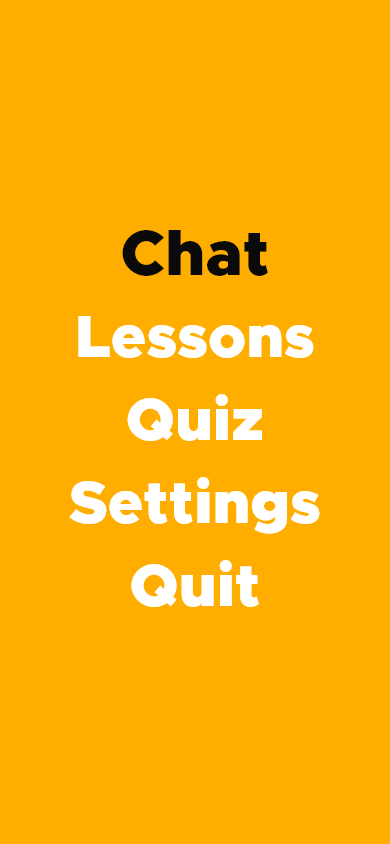
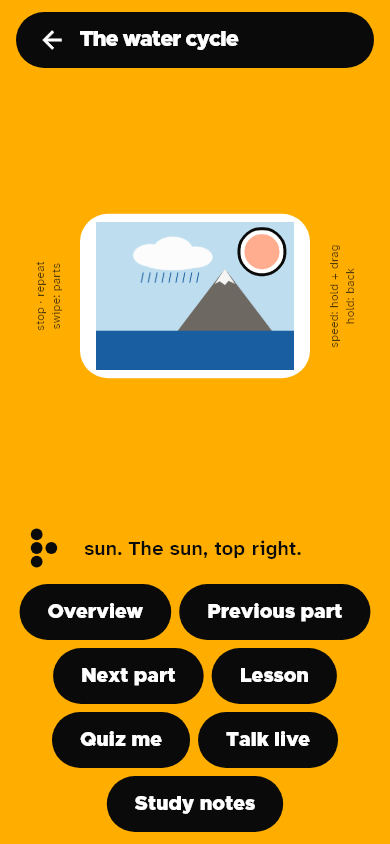
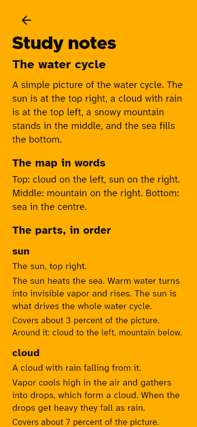
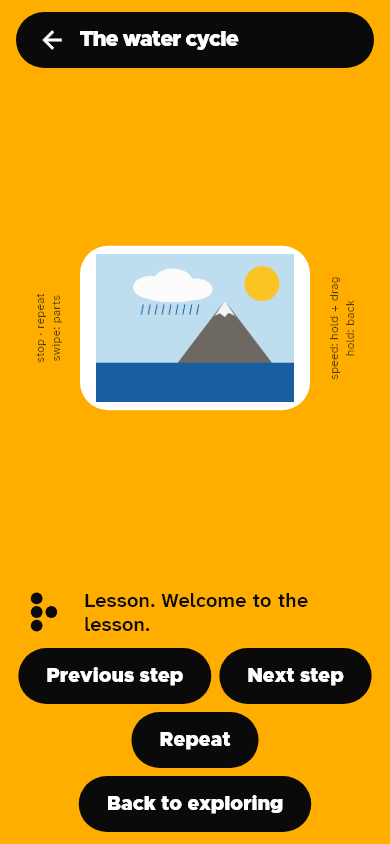
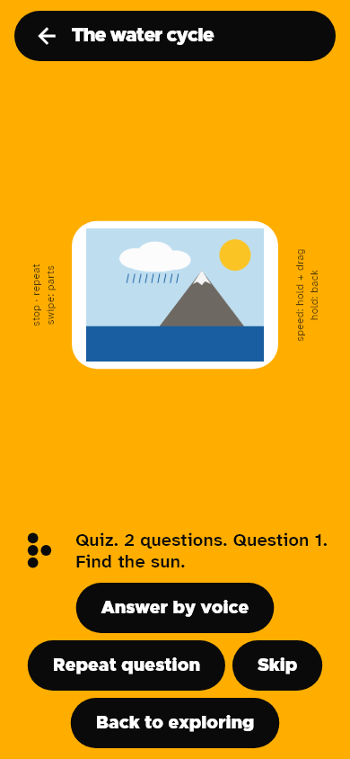
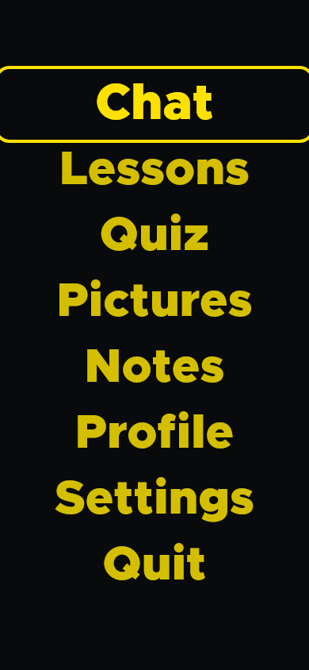

<div align="center">

# Resonant

**Learn by sound and touch.** Drag a finger across a picture and feel its parts.


[Screens](#screens) · [How it works](#how-it-works) · [Live voice](#live-voice-talk-live) · [Gestures](#gestures) · [Themes](#themes) · [Run it](#run-it) · [Status](#status--what-is-in-the-app-and-what-is-not) · [Credits](#credits)

</div>

Diagrams, charts and photos are the part of school that screen readers cannot reach. Alt text says
"a diagram of the water cycle" and stops. Resonant turns the picture itself into something a blind
student can explore. Each part speaks its name, buzzes under the fingertip (bigger parts buzz longer,
so size can be felt), and plays a tone whose **pitch is its height** on the page and whose **stereo
position is left to right**, so the whole picture can be heard as well as felt. Rest on empty space and
it says which way to walk to the nearest part.

The logo is the letter R in braille (⠗: dots 1-2-3-5), because sound and touch resonate through everything.

## Screens

Rendered from the real app with its own fonts and the bundled sample picture — not mockups.
Regenerate them with the golden-test generator in `tool/` (see `docs/screenshots/README.md`).

<div align="center">
<table>
<tr>
<td align="center"><br><b>Home</b><br><sub>Pick a picture, or try the sample</sub></td>
<td align="center"><br><b>Explore</b><br><sub>The sun, outlined and captioned</sub></td>
<td align="center"><br><b>Study notes</b><br><sub>The whole picture as readable text</sub></td>
</tr>
<tr>
<td align="center"><br><b>Lesson</b><br><sub>A guided walk through the parts</sub></td>
<td align="center"><br><b>Quiz</b><br><sub>Find it by touch, or answer out loud</sub></td>
<td align="center"><br><b>Low vision theme</b><br><sub>One of twelve, a tap away</sub></td>
</tr>
</table>
</div>

The braille R is also the app's face while it works: on the explore screen the dots gather when it is
listening, orbit while it thinks, and settle when it is idle — and every state also has a sound and a
vibration, so the face is a sighted extra, never the only signal.

## Pre-existing work

Resonant began as an Android app (Kotlin and Jetpack Compose) that I started **before** the
hackathon, for blind students to learn lessons by voice and gesture. That app is not part of this
repository and none of its code is copied in. These things were **carried over from it and rewritten in
Dart**:

| Carried over from the earlier app | Where it lives here |
| --- | --- |
| The name, the braille R logo and the dot animation geometry | `lib/core/ui/resonant_dots.dart`, `assets/brand/` |
| Colour palettes, shapes and sizes (all twelve of its themes) | `lib/core/theme/` |
| Fonts (Metropolis, Atkinson Hyperlegible Next) | `assets/fonts/`, see `NOTICE.md` |
| Gesture grammar: zones, timings, swipe inversion, hold-to-adjust-speed, three-finger gestures | `lib/features/touch/gestures/` |
| The haptic vocabulary and its matching sound cues, and the stereo-panning rule | `lib/core/services/haptics.dart`, `sound.dart` |

**Built during the hackathon** (everything else): the Muse Spark + SAM 3.1 backend that turns any
picture into touchable regions; exploring a picture with one finger (the explore gestures, mask
hit-testing, the fingertip-size haptic, rest-to-read, nearest-part directions); the height-to-pitch and
left-right-to-stereo sound mapping; hold-to-ask questions about the part under your finger; stepping
through parts from the edge; the Flutter app and its architecture, for Android, iPhone and web; and all
the tests.

**Ported from Resonant-AI during the hackathon, rewritten in Dart/JS/Python** (behaviour and wording only,
no old code copied; inventoried in `docs/HACKATHON.md`):

| Ported feature | Where it lives here |
| --- | --- |
| Lesson mode: guided steps through content, swipes navigate | `lib/features/learn/`, `POST /api/lesson` |
| Quiz / check-me: correct–incorrect haptic and sound feedback, score | `lib/features/learn/`, `POST /api/quiz`, `POST /api/grade` |
| Voice tutor chat (the old LiveKit agent, as hold-to-talk multi-turn chat) | `TouchSession` history + `POST /api/chat` |
| Live voice: a real conversation you can interrupt (the old PC agent, rewritten) | `agent/agent.py`, `POST /api/livekit-token`, the Talk live screen — *built; first on-phone call still to be made* |

## Status — what is in the app, and what is not

**Working today, on a real phone:**

- **Pick a picture** (gallery, camera, or two built-in samples), get it back as touchable parts in
  about half a minute, with spoken progress as each part lands. Analysis is cached on the backend,
  and the recents shelf reopens the session's pictures instantly.
- **Explore by touch**: each part speaks, buzzes (bigger parts buzz longer), and plays a tone whose
  pitch is its height and whose stereo position is left–right. Rest to hear the description; tap to
  hear what is around it; drag off a part and it tells you which way to go.
- **Map in words** (three-finger hold) and **Guide me there** ("Where is the sun?" by voice, then
  spoken direction + distance as you drag, with a celebration when you land on it).
- **Lesson mode**: Muse Spark writes a guided walk through the parts (with a built-from-the-parts
  fallback lesson, so it can never fail to start); swipe or tap through the steps.
- **Quiz me**: "find-it" questions graded on the phone against the SAM mask (instant, free), and
  "say-it" questions graded by Muse Spark. Correct/incorrect buzzes, one gentle retry, then the
  answer — and a **Practise missed** round with only the questions you got wrong.
- **Voice tutor**: hold, ask, lift — then follow up ("and why?"). The tutor remembers the
  conversation and knows which part your finger is on.
- **Study notes**: the whole picture as plain text (overview, map, every part with its clock-face
  position) for revision with a screen reader — and **Copy notes to share** pastes them anywhere.
- Screen-reader buttons for every gesture, twelve themes, a show-all-outlines view for sighted helpers,
  chart value readout with bar ranks, 339 Flutter tests + 44 backend tests, all green.

**Built, one step from proven:**

- **Talk live**: a real-time voice conversation with the tutor that you can interrupt mid-sentence.
  The backend token endpoint, the PC agent and the app screen are built and unit-tested; the first
  call on a real phone is still to be made. Until then the proven tutor is hold-to-talk, above, and
  the Talk live button stays hidden unless the app is built with `--dart-define=LIVE_VOICE=true`.

**Not built yet (deliberately — see `docs/HACKATHON.md`):**

- No public hosted link: for now the backend runs on your own computer and the phone talks to it
  over the same Wi-Fi. (A Modal hosting spike is planned; Baseten credits are held in reserve and
  untouched, because on-device speech works.)
- Nothing is saved between launches: the recents shelf holds the last five pictures for the
  session, with no accounts and no progress carried over. Practise-missed lasts for the quiz you are in.
- New pictures need the backend, a Meta API key and internet. Once a picture is analysed, exploring,
  the map and guiding work on the phone alone.
- SAM is honest but imperfect: a part it cannot outline stays touchable as an approximate rectangle,
  and the app says so out loud.

## How it works

```
 picture ──► Muse Spark 1.3 ──► title, overview, and a list of parts
                                (short noun phrases + what to say about each)
        │
        └──► SAM 3.1, once per part ──► exact pixel mask of every match
                                          │  shrunk to a 96-cell grid per part
                                          ▼
   phone: finger position → which mask is under it → speak, vibrate, play a tone, outline the part
```

- **Muse Spark** (`muse-spark-1.3`) reads the picture and decides what its parts are, in reading
  order. It also writes the guided lesson and the quiz from those parts (text-only calls, so they
  cost a fraction of an analysis), grades spoken answers, and answers spoken questions as a
  multi-turn tutor, using the part you last touched and the conversation so far as context.
- **SAM 3.1** (`sam-3.1`) turns each part name into pixel-accurate masks. The mask is what lets a finger
  land on a river or a lung, not just a rectangle. It is also what grades "find-it" quiz questions:
  the app hit-tests your finger against the mask, on the phone, for free.
- The two chain the way Meta's docs suggest: Muse Spark decides what to segment, SAM returns the geometry.
- The Meta key lives only on the backend. The app never holds it. Re-analyzing a picture you already
  opened is served from the backend's cache, not paid for twice.

## Live voice (Talk live)

Tap **Talk live** on the explore screen and just talk. Start speaking while the tutor is mid-sentence
and it stops and listens — that interruption is the point.

```
phone mic ──► LiveKit Cloud (free tier, carries audio only) ──► agent/agent.py on your PC
              Silero VAD hears you start ──► faster-whisper writes it down
              ──► Muse Spark answers ──► Piper speaks ──► back to the phone
```

Everything except the audio relay runs on your own machine and costs nothing: Silero and
faster-whisper listen locally, Piper is the local voice, and Muse Spark thinks on Meta credits.
The backend mints the student's room token (`POST /api/livekit-token`) and hides the picture's
context inside it, so the tutor already knows what you are looking at and which part you last
touched. Captions of both sides appear on screen as you talk.

```bash
cd agent && pip install -r requirements.txt
python agent.py download-files   # one-time: VAD + voice models
python agent.py dev              # then open a picture in the app and tap Talk live
python agent.py console          # no phone handy? Talk to it in the terminal
```

*Status: built end to end and unit-tested; the first on-phone call is still to be made (see Status).*

## Studying, not just exploring

Everything below is computed on the phone from the masks and boxes — no extra model calls, so it
works even when the network does not:

- **Map in words.** Three-finger hold reads the overview plus a three-band spoken map
  ("Top: cloud on the left, sun on the right. Middle: mountain…"), so the layout can be learned,
  not just visited.
- **Clock-face positions.** Study notes place every part on a clock face ("the sun, at 2 o'clock"),
  the way blind students are taught to share locations.
- **What's around it.** A quick tap on a part also names its neighbours ("Around it: cloud to the
  left, mountain below"), which is how a mental picture gets its edges.
- **Guide me there.** Hold and ask *"Where is the sun?"* and guide mode points you as you drag:
  rest and it says the direction and whether you are close or far, and celebrates when your finger
  lands on the mask.
- **Practise missed.** The quiz remembers the questions you missed, skipped or had revealed, and
  the end of the quiz offers a second round with only those.
- **Study notes.** A plain-text screen (overview, map in words, every part with its size, clock
  position and neighbours) that a screen reader can read top to bottom — revision without
  re-analyzing. **Copy notes to share** puts the same text on the clipboard for homework or a teacher.

## Gestures

Carried over from the earlier app, plus finger exploration:

| Where | Gesture | Does |
| --- | --- | --- |
| Centre | Touch or drag one finger | Explore: hear and feel the part under it |
| Centre | Move, then rest | Hear the part's description |
| Centre | Quick tap | Hear its name and description now, and what is around it |
| Centre | Double tap | Trace the touched part: drag and its edge buzzes under your finger; lift to stop |
| Centre | Hold still 0.5 s, speak, lift | Ask a question about the picture, or ask "Where is the …?" to be guided to it |
| Explore screen | Lesson / Quiz me / Talk live buttons | Guided lesson, a quiz (touch the part it names, answer out loud), or a live conversation |
| Lesson / Quiz | Left-edge swipe, buttons below | Next / previous step or question; hold right edge to go back to exploring |
| Left edge | Tap / double tap | Stop and resume talking / repeat |
| Left edge | Swipe (finger down = next) | Step through the parts without dragging |
| Right edge | Hold, then drag up or down | Speech faster or slower |
| Right edge | Hold without dragging | Back |
| Anywhere | Three-finger tap / hold | Repeat last / hear the overview and the map in words |

## Themes

The **Theme** line on Home cycles twelve themes carried over from Resonant: Resonant native,
Low vision (enormous contrast), Cataracts (high clarity), Handsfree (screen reader), Monochrome
(colorblind), Photophobia (low glare), Warm ambiance, Night red, Blue on yellow, Soft cream,
Paper gray and White on blue. They are not just colour swaps — the high-contrast ones add outlines
and change the corner shapes too. Every theme's text pairings are checked at 7:1 or better by a
unit test (`test/palette_test.dart`), so a future edit cannot quietly make a theme unreadable.

## Architecture

```
lib/
  core/            speech, haptics, sound behind interfaces; theme; the animated braille logo
  features/touch/
    domain/        Region, Analysis, hit-testing, spatial words (map, neighbours, clock)  (pure Dart)
    gestures/      the gesture engine: touches -> gestures (pure Dart, no clock, no timers)
    application/   TouchSession: gestures -> speech/touch/sound  (pure Dart) + Riverpod controller
    data/          the backend client
    presentation/  screens, the gesture surface, the picture painter
  features/learn/
    domain/        Lesson, Quiz, Grade                     (pure Dart)
    application/   LearnSession: lesson steps + quiz grading (pure Dart)
backend/           Node: Muse Spark + SAM 3.1 -> regions; Spark -> lesson, quiz, tutor chat; LiveKit tokens
agent/             Python: the Talk live tutor (Silero, faster-whisper, Muse Spark, Piper)
```

Every effect (voice, vibration, tones, microphone, network) sits behind an interface, so the whole
behaviour of the app is unit-tested without a phone. The Flutter layer only draws state and feeds in touches.

## Run it

Needs the [Flutter SDK](https://docs.flutter.dev/get-started/install), Node 20.17+, and a Meta Model API key from <https://dev.meta.ai/platform>.

```bash
# 1. Backend (holds your key)
cd backend && npm install && cp .env.example .env     # put your key in MODEL_API_KEY
npm run check:api                                      # one Muse Spark call and one SAM call: confirms the key works
npm start                                              # http://localhost:3000

# 2. App (new terminal, from the repo root)
tool/setup.sh                                          # generates android/ ios/ web/, adds permissions
flutter test
flutter run --dart-define=API_BASE=http://<your-computer's-ip>:3000
```

**Try a sample** works with no key: both bundled outlines (the water cycle by
`backend/scripts/make-sample.py`, the rainfall chart by `backend/scripts/make-chart-sample.py`) are
hand-authored, not model output, and the app says so out loud. Extra samples served from the
backend's `sample/` folder appear in the same gallery via `GET /api/samples`.

### iPhone

See [`docs/IPHONE.md`](docs/IPHONE.md). Short version: the web build runs in iPhone Safari from a link, with
speech and sound, but not vibration, because Safari has none. A native iPhone build has the haptics.

## Tests

```bash
flutter test            # gestures, hit-testing, sessions, charts, recents, gallery, overlays, notes, themes, sound, dots, shell, nav, home, gallery, talk, notes, touch, settings, splash, hints (339 tests)
cd backend && npm test  # the Meta pipeline, streaming, samples gallery, lesson/quiz/chat API, LiveKit tokens (44 tests)
```

## Known limits

- Analysis takes roughly half a minute because every part is its own SAM request (five run at a
  time, with spoken progress; raise `SAM_CONCURRENCY` for more). The recents shelf keeps the session's
  pictures so going back is instant.
- SAM 3.1 matches one concept per request, so a vaguely phrased label can match nothing. The backend retries with simpler concepts; if it still finds nothing but Muse Spark gave a rough box, the part stays touchable as an approximate rectangle (the app says so), and many tiny matches in one photo (every tooth in a close-up) are merged into one region.
- Vibration is timed on Android. On iPhone it is a series of taps, and none at all in the browser.
- With TalkBack or VoiceOver on, the screen reader takes over one-finger touch, so use the buttons under the picture.
- Talk live needs the agent running on a computer on the same network, and its first on-phone call is still to be made.

## Credits

Resonant stands on a lot of generous work. Each of these keeps its own license.

| What | Used for | License |
| --- | --- | --- |
| Meta Model API (Muse Spark 1.3, SAM 3.1) | Naming parts, lessons, quizzes, grading, the tutor's brain; exact picture masks | Meta Model API terms |
| [LiveKit](https://livekit.io) + LiveKit Agents | Carrying live voice between the phone and the PC agent (free tier) | Apache-2.0 |
| [Silero VAD](https://github.com/snakers4/silero-vad) | Hearing when you start and stop talking | MIT |
| [faster-whisper](https://github.com/SYSTRAN/faster-whisper) | Writing down what you said, on your own PC | MIT |
| [Kokoro](https://github.com/hexgrad/kokoro) via [kokoro-onnx](https://github.com/thewh1teagle/kokoro-onnx) | The tutor's spoken voice, on your own PC (Piper is the fallback) | Apache-2.0 (model), MIT |
| [Piper](https://github.com/rhasspy/piper) | Fallback spoken voice, on your own PC | MIT |
| Flutter, Riverpod | The app itself, Android / iOS / web | BSD-3-Clause, MIT |
| [Atkinson Hyperlegible Next](https://github.com/googlefonts/atkinson-hyperlegible-next) | Body typeface, made for low vision | SIL OFL 1.1 |
| Metropolis | Display typeface and the wordmark | The Unlicense (public domain) |

The initial project scaffold was written with help from Claude (Anthropic) as a coding assistant.

## License

MIT. See `LICENSE` and `NOTICE.md`.
