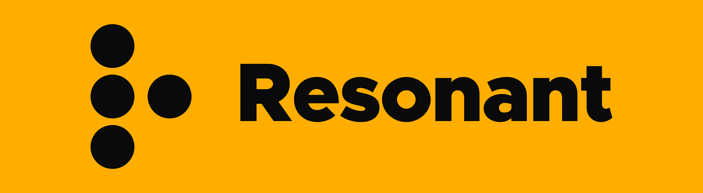
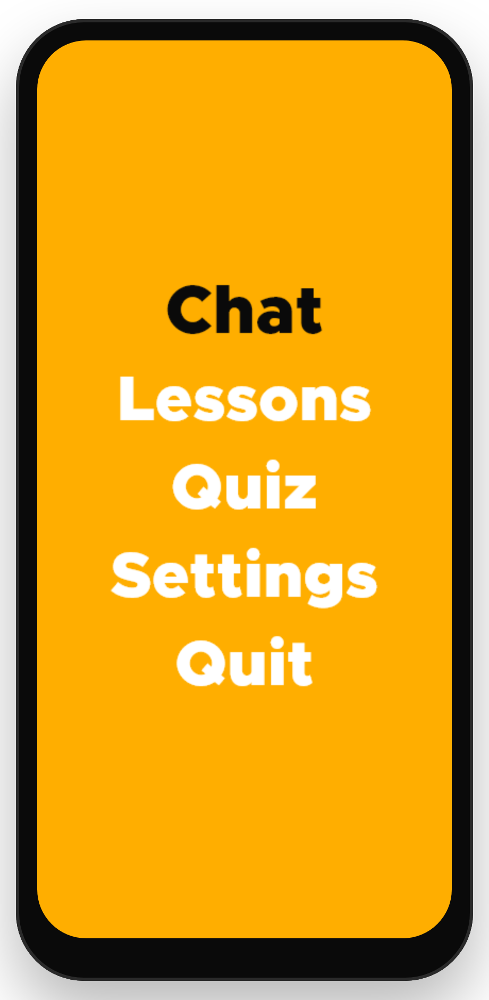
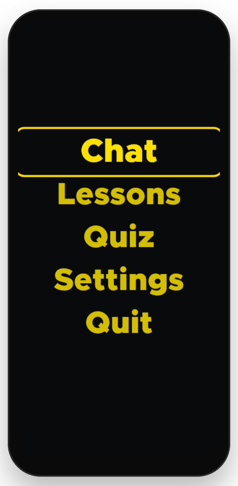
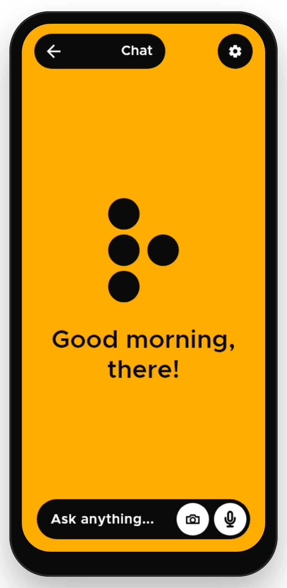
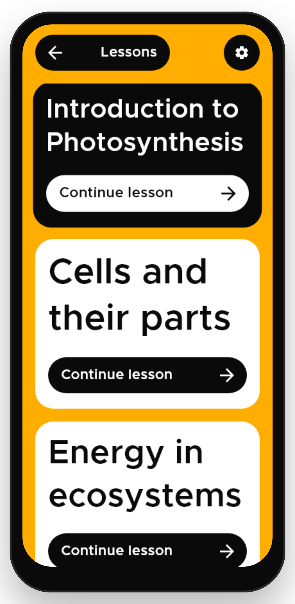
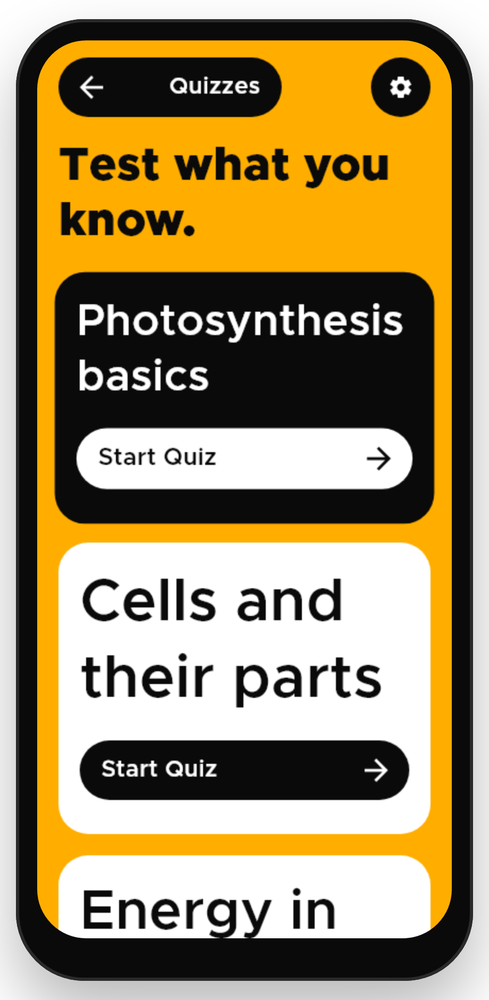
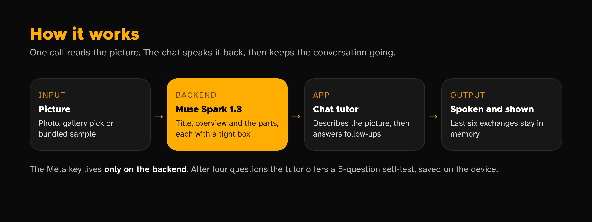
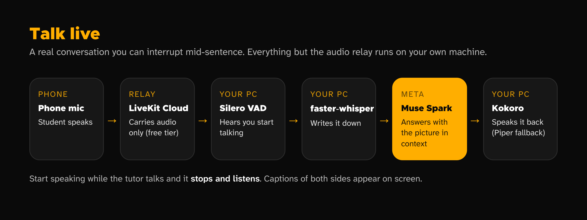

<div align="center">

<h1></h1>

**A voice tutor for pictures.** Photograph anything, ask anything, hold a conversation.

[Why](#why-resonant) · [Screens](#screens) · [How it works](#how-it-works) · [Live voice](#live-voice-talk-live) · [Gestures](#gestures) · [Sound and haptics](#sound-and-haptics) · [TalkBack](#talkback-and-voiceover) · [Themes](#themes) · [Run it](#run-it) · [Status](#status--what-is-in-the-app-and-what-is-not) · [Credits](#credits)

</div>

Diagrams, charts and photos are the part of school that screen readers cannot reach. Alt text says
"a diagram of the water cycle" and stops. Resonant is a voice tutor for pictures: photograph
anything or pick from the gallery, the AI reads it and describes what it sees, and then you just
talk — ask anything, follow up, hold a conversation. Six built-in lessons and four quiz sets
round it out for studying offline — and after four questions the tutor offers a self-test
on what you discussed, saved for offline review.

Every answer is spoken and shown: tap to talk, or type. The tutor remembers the last six
exchanges, so follow-ups ("and why?") just work. With a picture attached it sees the picture
too; without one it is a text-only tutor on the same voice.

The logo is the letter R in braille (⠗: dots 1-2-3-5), because sound and touch resonate through everything.

## Why Resonant

Most apps assume you can see the screen: find the button, tap the button. For someone who can't, that is the whole problem.

Resonant takes the screen out of the equation. There is nothing to find. Gestures are read by zone, not by position, they mean the same thing on every screen, and every action answers back in speech, a vibration pattern, and a tone.

- **Learn by listening.** Lessons are read aloud one unit at a time. Pause, repeat, slow down, speed up.
- **Ask instead of searching.** Talk to the tutor and hear the answer.
- **Quizzes without looking.** Every answer option has its own counted buzz and tone.
- **No perfect connection needed.** The study library works fully offline, and chat falls back to the lessons when the server is down.
- **Made for every kind of low vision, too.** Twelve color themes, adjustable text size and spacing, and a Reduce motion switch.

## Screens

Rendered from the real app with its own fonts and the bundled sample picture — not mockups.
Regenerate them with the golden-test generator in `tool/` (see `docs/screenshots/README.md`).

<div align="center">
<table>
<tr>
<td align="center"><br><b>Home</b><br><sub>Five lines, Chat first</sub></td>
<td align="center"><br><b>Low vision theme</b><br><sub>One of twelve, a tap away</sub></td>
<td align="center"><br><b>Chat</b><br><sub>The voice tutor, by text or mic</sub></td>
</tr>
<tr>
<td align="center"><br><b>Lessons</b><br><sub>Six lessons that read themselves</sub></td>
<td align="center"><br><b>Quizzes</b><br><sub>Four sets, with retry rounds</sub></td>
</tr>
</table>
</div>

Everything is driven by gestures; the screen is for sighted helpers and for people with some vision. Focus is always drawn as the inverted item, so it is never only spoken.

The braille R is also the app's face while it works: in chat the dots gather when it is
listening, orbit while it thinks, and settle when it is idle — and every state also has a sound
and a vibration, so the face is a sighted extra, never the only signal.

<div align="center">

<br><sub>Idle, listening, thinking, speaking. Pose maths ported line for line from <code>lib/core/ui/dots_engine.dart</code> (<code>tool/readme-assets/dots_gif.py</code>).</sub>
</div>

## Pre-existing work

Resonant began as an Android app (Kotlin and Jetpack Compose) that I started **before** the
hackathon, for blind students to learn lessons by voice and gesture. That app is not part of this
repository and none of its code is copied in. These things were **carried over from it and rewritten in
Dart**:

| Carried over from the earlier app | Where it lives here |
| --- | --- |
| The name, the braille R logo and the dot animation geometry | `lib/core/ui/resonant_dots.dart`, `assets/brand/` |
| Colour palettes, shapes and sizes (all twelve of its themes) | `lib/core/theme/` |
| Fonts (Metropolis, Atkinson Hyperlegible Next) | `assets/fonts/`, see `NOTICE.md` |
| Gesture grammar: zones, timings, swipe inversion, hold-to-adjust-speed, three-finger gestures | `lib/features/touch/gestures/` |
| The haptic vocabulary and its matching sound cues, and the stereo-panning rule | `lib/core/services/haptics.dart`, `sound.dart` |

**Built during the hackathon** (everything else): the Muse Spark backend that reads any
picture into named parts; the chat-first Flutter app for Android, iPhone and web (camera sheet,
the AI tutor with conversation memory, Talk live wiring); and all the tests.

**Ported from Resonant-AI during the hackathon, rewritten in Dart/JS/Python** (behaviour and wording only,
no old code copied; inventoried in `docs/private/HACKATHON.md`):

| Ported feature | Where it lives here |
| --- | --- |
| Voice tutor chat (tap to talk, multi-turn with memory) | `ChatSession` history + `POST /api/chat` |
| Live voice: a real conversation you can interrupt (the old PC agent, rewritten) | `agent/agent.py`, `POST /api/livekit-token`, the Talk live screen — *built; first on-phone call still to be made* |
| Study screens: home menu, chat hero, lesson library and reader, quiz sets with retry rounds, settings with option previews | `lib/features/touch/presentation/`, `lib/features/learn/domain/` |

## Status — what is in the app, and what is not

**Working today, on a real phone:**

- **Add a picture** from chat's camera button: take a photo, choose from the
  gallery, try a sample, or reopen a recent. The AI reads it in seconds, with
  spoken progress, then describes what it sees — title, parts, overview.
- **Talk to the tutor**: tap to start, speak, tap to finish — or type. Answers
  are spoken and shown; follow-ups ("and why?") carry the last six exchanges,
  so real conversations hold. With a picture attached the tutor sees it too.
- **Study library**: six built-in lessons that read themselves, four quiz sets
  with retry rounds, and settings that preview each theme, font and size before
  keeping it — all working offline, with progress kept for the session. After four chat
  questions the tutor offers a 5-question self-test on the topic, saved on the device
  under "From your chats" and available offline once generated.
- Screen-reader buttons for every gesture, twelve themes, a spoken-and-shown gesture
  guide on each screen's first visit (Settings replays them), 426 Flutter tests +
  43 backend tests, all green.

**Built, one step from proven:**

- **Talk live**: a real-time voice conversation with the tutor that you can interrupt mid-sentence.
  The backend token endpoint, the PC agent and the chat entry button are built and unit-tested;
  the first call on a real phone is still to be made. Until then the proven tutor is tap-to-talk,
  above, and the Talk live button stays hidden unless the app is built with `--dart-define=LIVE_VOICE=true`.

**Not built yet (deliberately — see `docs/private/HACKATHON.md`):**

- No public hosted link: for now the backend runs on your own computer and the phone talks to it
  over the same Wi-Fi. (A Modal hosting spike is planned; Baseten credits are held in reserve and
  untouched, because on-device speech works.)
- Little persists between launches: settings, the tutorial and guide flags, and quizzes
  the tutor generated stay on the device; the recents shelf holds the last five
  pictures for the session, with no accounts and no progress carried over.
- New pictures need the backend, a Meta API key and internet. The study library and the
  built-in samples work fully offline.
- The parts list is the model's reading of the picture; the tutor answers from the picture
  itself, so a missed part never blocks a question.

## How it works



<details>
<summary>Text version</summary>

```
 picture ──► Muse Spark 1.3 ──► title, overview, and a list of parts
                                (short noun phrases + a tight box + what to say about each)
                                          │  one call, then the chat speaks it back
                                          ▼
   chat: the tutor describes the picture, then answers follow-ups from the
   picture and the last six exchanges
```

</details>

- **Muse Spark** (`muse-spark-1.3`) reads the picture and decides what its parts are, in reading
  order, with a tight box around each one. The chat announces the title, the parts and the
  overview, then the same model answers follow-up questions as a multi-turn tutor, seeing the
  picture and the conversation so far.
- Without a picture open, chat is a text-only tutor on the same endpoint: same voice,
  no picture to look at. When the server is unreachable, the six built-in lessons answer instead,
  and the app says so.
- After four questions in one conversation the tutor offers a self-test once: `POST
  /api/quiz` turns the topic and the conversation into 5 multiple-choice questions
  (3-4 options, the correct index, a one-line explanation), saved on the device.
- The Meta key lives only on the backend. The app never holds it. Re-analyzing a picture you already
  opened is served from the backend's cache, not paid for twice.

What chat does so that silence never looks like a crash: it says "Listening." first and opens the mic only when it has finished (otherwise the recognizer hears the app's own voice); while the model works it pulses softly and says "Still thinking. Tap the center to cancel."; tapping while an answer is spoken starts a new question; and every failure is announced in one plain sentence, never an HTTP body.

## Live voice (Talk live)

Tap **Talk live** in chat (with a picture attached) and just talk. Start speaking while the tutor is mid-sentence
and it stops and listens — that interruption is the point.



<details>
<summary>Text version</summary>

```
phone mic ──► LiveKit Cloud (free tier, carries audio only) ──► agent/agent.py on your PC
              Silero VAD hears you start ──► faster-whisper writes it down
              ──► Muse Spark answers ──► Kokoro speaks (Piper is the fallback) ──► back to the phone
```

</details>

Everything except the audio relay runs on your own machine and costs nothing: Silero and
faster-whisper listen locally, Kokoro is the local voice with Piper as the fallback, and Muse
Spark thinks on Meta credits. The backend mints the student's room token (`POST /api/livekit-token`)
and hides the picture's context inside it, so the tutor already knows what you are looking at.
Captions of both sides appear on screen as you talk.

```bash
cd agent && pip install -r requirements.txt
python agent.py download-files   # one-time: VAD + voice models
python agent.py dev              # then attach a picture in the app's chat and tap Talk live
python agent.py console          # no phone handy? Talk to it in the terminal
```

*Status: built end to end and unit-tested; the first on-phone call is still to be made (see Status).*

## Gestures

<div align="center">

</div>

Gestures are read by zone (left edge, center, right edge) using relative boundaries, so nothing depends on fixed screen coordinates. They are almost the same on every screen. Holds are decided by a real timeout, so the "hold engaged" haptic fires at the half-second mark, not on release.

| Where | Gesture | Does |
| --- | --- | --- |
| Centre | Tap | Chat: ask by voice, or cancel while thinking; menus: open the focused line; elsewhere select / confirm |
| Centre | Swipe down / up (one finger) | Next / previous: quiz option, chat sentence, lesson-mode choice |
| Centre | Swipe down / up (two fingers) | Next / previous on menus and scrolling lists. One finger scrolls those lists instead |
| Centre | Swipe right / left | Continue or submit / back (lesson: next / previous section; quiz: submit) |
| Left edge | Tap | Pause / resume speech, from the exact spot you paused at |
| Left edge | Double tap | Repeat the current unit |
| Left edge | Swipe (finger down = next) | Step through items or sentences |
| Right edge | Hold ~½ s (three quick ticks), then drag up / down | Speech faster / slower, in steps (0.75×–2.0×); remembered between launches |
| Right edge | Hold ~½ s, release without dragging | Back / leave screen |
| Right edge | Tap | Nothing, deliberately (no accidental triggers) |
| Anywhere | Three-finger tap | Repeat the current unit |
| Anywhere | Three-finger hold | "Where am I?" — screen, position, playback state |
| Quiz answers | Swipe to browse, tap to choose, swipe right | Answer; each option buzzes its letter |
| Settings rows | Hold a theme / font / size row, swipe sideways | Preview each option on screen and by voice ("Warm, 7 of 12"), tap to keep, hold the right edge to cancel |
| Chat pill | Type, mic, camera buttons | Ask by text, voice, or attach a picture |

**Spoken hints.** If you go quiet, the screen says one short hint, for example "Swipe down for the next option, tap the middle to choose, or hold three fingers to hear where you are." It speaks after about 25 s of silence from both you and the app, or after three gestures in a row that did nothing ("Having trouble?"). It never speaks over the app's own voice, while paused, in the background, or in the tutorial, at most three per visit to a screen.

**Tutorial and practice area.** Every first launch goes through a spoken gesture tutorial (a hold on the left edge skips it). After it comes a practice area: try any gesture and Resonant says what you just did and what it means ("You just swiped down with two fingers, which means next"), with the real haptic and tone, and nothing is acted on. Settings replays it.

## Sound and haptics

Every action answers in three ways at once: speech, a vibration pattern and a short tone.

- **Haptics** are a named vocabulary of patterns kept in one place. Quiz options A–D are a separate, counted family of long pulses (1–4) that shares nothing with the navigation patterns.
- **Sound cues** are one tone per haptic pattern, generated in code (no audio files), kept above 300 Hz because phone speakers can't reproduce lower notes. Several patterns buzz almost alike (a 50 ms pulse is both "next" and "confirm"); their tones do not. Direction is pitch contour (rising = forward / faster / correct, falling = back / slower / wrong), quiz options are 1–4 beeps, and the repeating "thinking" tick is much quieter than the rest. They follow media volume and can be switched off in Settings.
- **Stereo panning.** With headphones connected, every cue sits a little to one side so it is not heard as part of the voice: back, slower and wrong on the left, everything else on the right, the far ear at 65% rather than silent so a single earbud still hears them all. Speech is never moved. On the phone speaker nothing is panned.
- **Quiz feedback** never depends on telling red from green: the result shows a check or a cross and the words Correct or Incorrect, and the two fills always differ a lot in brightness.

<div align="center">

</div>

## TalkBack and VoiceOver

Resonant's gestures are raw touches read by its own detector. With a screen reader on, the screen reader owns the touch stream, so Resonant's swipes, taps and holds never arrive. The app detects this and shows a notice with two ways forward:

1. Turn the screen reader off and use the gestures above.
2. Keep it on and use the buttons on each screen. Every gesture (Next, Previous, Select, Continue, Back, Leave screen, Pause or resume, Repeat, Where am I, Faster, Slower) has a screen-reader button that goes through the same handler as the real gesture.

Known limit: Resonant's own voice and the screen reader's voice can overlap, and this has not yet been tested with real screen-reader users.

## Themes

Twelve themes carried over from Resonant, switched in Settings: Resonant native,
Low vision (enormous contrast), Cataracts (high clarity), Handsfree (screen reader), Monochrome
(colorblind), Photophobia (low glare), Warm ambiance, Night red, Blue on yellow, Soft cream,
Paper gray and White on blue. They are not just colour swaps — each one also sets its own
corner radius, outline and edge contrast, so they feel like different places: Low vision uses tight 12 dp
corners with a yellow outline, Monochrome 4 dp with a black outline, Photophobia 36 dp cards with pill buttons.
Every theme except the default keeps its card, bar and button edges visible (an outline or at least 3:1 against
the screen); the default orange theme is exempt on purpose, because white cards on orange are the brand look.

Every theme's text pairings are checked at 7:1 or better by a unit test (`test/palette_test.dart`), so a
future edit cannot quietly make a theme unreadable. Body text is one solid, full-opacity colour per theme,
never alpha-blended, and the focused item is a solid filled chip rather than a colour swap, so contrast never
depends on where text sits on the background.

Each theme also has its own type and motion defaults until you pick yours: Low vision, Cataracts and
Handsfree start with Atkinson Hyperlegible, the calm themes with a softer face, the rest with Metropolis. The
light-sensitive themes (Photophobia, Night red) stay completely still; the low-vision ones draw a thick steady
ring around the focused card instead of animating it. A Reduce motion switch turns animation off everywhere,
and motion is never the only signal.

<div align="center">

<br><sub>Drawn from the colours, outlines and corner radii in <code>lib/core/theme/palettes.dart</code>; the contrast figure is text on background. Captured screenshots of every theme: see below.</sub>
</div>

<div align="center">

</div>

To capture all twelve from the real app, run the generator in `tool/` (see `docs/screenshots/README.md`); they land in `docs/screenshots/themes/`.

### Type and touch size

The type scale is tuned for low vision: body text starts large, line heights are generous (tight leading is hard to track with field loss), and the smallest text on screen is still 20 sp. Settings cycles text size, typeface and text spacing, and previews each before you keep it. Anything you tap is at least 56 dp, and screen margins are symmetric.

## Architecture

```
lib/
  core/            speech, haptics, sound behind interfaces; theme; the animated braille logo
  features/touch/
    gestures/      the gesture engine: touches -> menu navigation (pure Dart, no clock, no timers)
    application/   ChatSession: conversation -> speech (pure Dart) + pictures intake and quiz shelf (Riverpod)
    data/          the backend client (analyze + chat + quiz + gallery)
    presentation/  home, chat + camera sheet, lessons, quizzes, settings
  features/learn/
    domain/        library lessons, quiz sets, progress, offline answers (pure Dart)
    application/   lesson + quiz readers (pure Dart)
backend/           Node: Muse Spark reads pictures; the chat tutor; gallery samples; LiveKit tokens
agent/             Python: the Talk live tutor (Silero, faster-whisper, Muse Spark, Kokoro/Piper)
```

Every effect (voice, vibration, tones, microphone, network) sits behind an interface, so the whole
behaviour of the app is unit-tested without a phone. The Flutter layer only draws state and feeds in touches.

## Run it

Needs the [Flutter SDK](https://docs.flutter.dev/get-started/install), Node 20.17+, and a Meta Model API key from <https://dev.meta.ai/platform>.

```bash
# 1. Backend (holds your key)
cd backend && npm install && cp .env.example .env     # put your key in MODEL_API_KEY
npm run check:api                                      # one Muse Spark call: confirms the key works
npm start                                              # http://localhost:3000

# 2. App (new terminal, from the repo root)
tool/setup.sh                                          # generates android/ ios/ web/, adds permissions
flutter test
flutter run --dart-define=API_BASE=http://<your-computer's-ip>:3000
```

**Try a sample** in the camera sheet works with no key: both bundled pictures (the water cycle by
`backend/scripts/make-sample.py`, the rainfall chart by `backend/scripts/make-chart-sample.py`) are
hand-authored, not model output, and the app says so out loud. Extra samples served from the
backend's `sample/` folder appear in the same sheet via `GET /api/samples`.

### iPhone

See [`docs/IPHONE.md`](docs/IPHONE.md). Short version: the web build runs in iPhone Safari from a link, with
speech and sound, but not vibration, because Safari has none. A native iPhone build has the haptics.

## Tests

```bash
flutter test            # gestures, phrases, guides, chat, quiz offer + shelf, camera sheet, pictures intake, lessons, quizzes, library, progress, themes, sound, dots, shell, nav, home, settings, splash, first-run (426 tests)
cd backend && npm test  # analyze, text + picture chat, quiz generation, samples gallery, streaming, LiveKit tokens (43 tests)
```

## Known limits

- Analysis is one Muse Spark call, so a new picture takes several seconds, with spoken progress
  as each part lands. The recents shelf keeps the session's pictures so going back is instant.
- A part the model cannot place is left out of the spoken parts list; the tutor answers from the picture itself, so a missed part never blocks a question.
- Vibration is timed on Android. On iPhone it is a series of taps, and none at all in the browser.
- With TalkBack or VoiceOver on, the screen reader takes over one-finger touch, so use the buttons on each screen.
- Talk live needs the agent running on a computer on the same network, and its first on-phone call is still to be made.

## Credits

Resonant stands on a lot of generous work. Each of these keeps its own license.

| What | Used for | License |
| --- | --- | --- |
| Meta Model API (Muse Spark 1.3) | Reading pictures, the tutor's brain | Meta Model API terms |
| [LiveKit](https://livekit.io) + LiveKit Agents | Carrying live voice between the phone and the PC agent (free tier) | Apache-2.0 |
| [Silero VAD](https://github.com/snakers4/silero-vad) | Hearing when you start and stop talking | MIT |
| [faster-whisper](https://github.com/SYSTRAN/faster-whisper) | Writing down what you said, on your own PC | MIT |
| [Kokoro](https://github.com/hexgrad/kokoro) via [kokoro-onnx](https://github.com/thewh1teagle/kokoro-onnx) | The tutor's spoken voice, on your own PC (Piper is the fallback) | Apache-2.0 (model), MIT |
| [Piper](https://github.com/rhasspy/piper) | Fallback spoken voice, on your own PC | MIT |
| Flutter, Riverpod | The app itself, Android / iOS / web | BSD-3-Clause, MIT |
| [Atkinson Hyperlegible Next](https://github.com/googlefonts/atkinson-hyperlegible-next) | Body typeface, made for low vision | SIL OFL 1.1 |
| Metropolis | Display typeface and the wordmark | The Unlicense (public domain) |

The initial project scaffold was written with help from Claude (Anthropic) as a coding assistant.

## License

MIT. See `LICENSE` and `NOTICE.md`.
